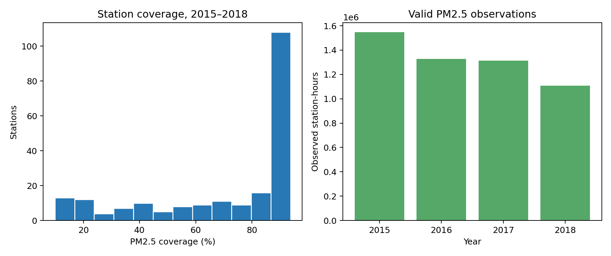

# 空气质量数据质量报告

## 处理范围

原表共有 5,458,280 行。为了让时序模型和图模型比较公平，本项目选取训练期至少有一个 PM2.5 真值、且站点表提供经纬度的节点。最终得到 212 个站点，选中站点对应 5,430,923 行记录。

逐小时数组覆盖 2015—2018 年，共 35,064 小时。所有原始时间均恰好落在整点，未发现同一站点同一小时的重复行。缺失值保留为 `NaN`。

## 训练期统计

标准化参数只根据 2015—2016 年计算：

| 污染物 | 均值 | 标准差 | 有效站点小时数 |
|---|---:|---:|---:|
| PM2.5 | 50.8140 | 40.3591 | 2,875,613 |
| PM10 | 80.3355 | 56.0072 | 2,729,206 |
| NO2 | 37.2848 | 27.3002 | 2,799,973 |
| CO | 0.9754 | 0.8436 | 2,809,302 |
| O3 | 63.8949 | 47.6743 | 2,800,689 |
| SO2 | 19.8140 | 29.8888 | 2,820,040 |

这些数值用于训练数据的标准化，不能用 2017 或 2018 年重新估计。

## 对建模的直接影响

站点 PM2.5 四年平均覆盖率约为 71.3%，中位数约为 86.9%。不同站点的启用和停用时间不一致，整行缺失比单看原 CSV 中的空单元格更明显。因此，历史输入需要同时保留缺失掩码，未来缺失标签必须从损失和评价中排除。模型比较还应使用共同有效的标签集合。

